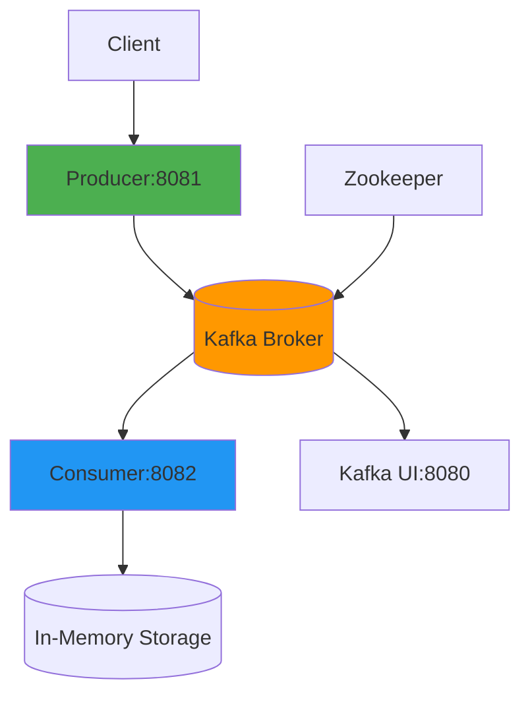

# Kafka Microservices Project

Um projeto completo de microserviços utilizando Spring Boot, Apache Kafka e Docker, desenvolvido com as tecnologias mais atualizadas de novembro de 2025.

## 📋 Índice

- [Visão Geral](#visão-geral)
- [Arquitetura](#arquitetura)
- [Tecnologias](#tecnologias)
- [Pré-requisitos](#pré-requisitos)
- [Instalação e Execução](#instalação-e-execução)
- [API Endpoints](#api-endpoints)
- [Monitoramento](#monitoramento)
- [Estrutura do Projeto](#estrutura-do-projeto)
- [Desenvolvimento](#desenvolvimento)
- [Troubleshooting](#troubleshooting)

## 🚀 Visão Geral

Este projeto demonstra uma arquitetura de microserviços moderna utilizando:
- **Producer**: Serviço responsável por produzir mensagens para tópicos Kafka
- **Consumer**: Serviço responsável por consumir e processar mensagens dos tópicos Kafka
- **Apache Kafka**: Plataforma de streaming de eventos em tempo real
- **Docker**: Containerização de todos os serviços

## 🏗️ Arquitetura



## 🛠️ Tecnologias

- **Java 21** - Linguagem de programação
- **Spring Boot 3.5.4** - Framework principal
- **Apache Kafka 7.5.0** - Mensageria distribuída
- **Gradle Kotlin DSL** - Gerenciamento de dependências
- **Docker & Docker Compose** - Containerização
- **Kafka UI** - Interface web para monitoramento do Kafka

## 📋 Pré-requisitos

- **Docker** versão 20.10+ e **Docker Compose** versão 1.29+
- **Java 21** (apenas para desenvolvimento)
- **Gradle 8.0+** (apenas para desenvolvimento)

## 🚀 Instalação e Execução

### Método 1: Execução Rápida com Scripts Automatizados

```bash
# Clone o projeto
git clone https://github.com/dev-emartins/spring_boot-kafka-docker.git
cd spring_boot-kafka-docker

# Torne os scripts executáveis
chmod +x build.sh run.sh stop.sh test.sh

# Build do projeto
./build.sh

# Iniciar todos os serviços
./run.sh
```

### Método 2: Execução Manual com Docker Compose

```bash
# Build dos projetos
cd producer && ./gradlew build -x test && cd ..
cd consumer && ./gradlew build -x test && cd ..

# Iniciar infraestrutura
docker compose up -d zookeeper kafka kafka-ui

# Aguardar Kafka estar pronto (45-60 segundos)
sleep 45

# Iniciar aplicações
docker compose up -d producer consumer
```

### Método 3: Desenvolvimento Local

```bash
# Iniciar apenas Kafka e dependências
docker compose up -d zookeeper kafka kafka-ui

# Executar Producer localmente
cd producer
./gradlew bootRun

# Executar Consumer localmente (em outro terminal)
cd consumer  
./gradlew bootRun
```

## 📡 API Endpoints

### Producer API (Porta 8081)

| Método | Endpoint | Descrição |
|--------|----------|-----------|
| `POST` | `/producer/api/messages/user` | Envia mensagem de usuário |
| `POST` | `/producer/api/messages/order` | Envia mensagem de pedido |
| `POST` | `/producer/api/messages/sample/user` | Gera e envia usuário de exemplo |
| `POST` | `/producer/api/messages/sample/order` | Gera e envia pedido de exemplo |
| `GET` | `/producer/api/messages/health` | Health check da API |

**Exemplo de requisição:**
```bash
# Enviar usuário de exemplo
curl -X POST http://localhost:8081/producer/api/messages/sample/user

# Enviar pedido personalizado
curl -X POST http://localhost:8081/producer/api/messages/order \
  -H "Content-Type: application/json" \
  -d '{
    "id": "order-123",
    "productName": "Notebook Gamer",
    "amount": 2500.00,
    "quantity": 1,
    "timestamp": "2025-11-15T10:30:00"
  }'
```

### Consumer API (Porta 8082)

| Método | Endpoint | Descrição |
|--------|----------|-----------|
| `GET` | `/consumer/api/stats/users` | Estatísticas de usuários processados |
| `GET` | `/consumer/api/stats/orders` | Estatísticas de pedidos processados |
| `GET` | `/consumer/api/stats/summary` | Resumo geral de processamento |
| `GET` | `/consumer/api/stats/health` | Health check da API |

**Exemplo de consulta:**
```bash
# Ver resumo
curl http://localhost:8082/consumer/api/stats/summary

# Ver usuários processados
curl http://localhost:8082/consumer/api/stats/users
```

## 📊 Monitoramento

### Kafka UI
Acesse a interface web do Kafka para monitorar tópicos, consumidores e mensagens:
```
http://localhost:8080
```

**Funcionalidades disponíveis:**
- Visualização de tópicos (`user-topic`, `order-topic`)
- Monitoramento de consumidores
- Inspeção de mensagens em tempo real
- Métricas de performance

### Health Checks
```bash
# Verificar status de todos os serviços
curl http://localhost:8081/producer/api/messages/health
curl http://localhost:8082/consumer/api/stats/health
```

## 📁 Estrutura do Projeto

```
spring_boot-kafka-docker/
├── producer/                    # Microserviço produtor
│   ├── src/main/java/com/example/producer/
│   │   ├── config/KafkaConfig.java
│   │   ├── controller/MessageController.java
│   │   ├── dto/UserMessage.java
│   │   ├── dto/OrderMessage.java
│   │   └── service/KafkaProducerService.java
│   ├── build.gradle.kts
│   └── Dockerfile
├── consumer/                    # Microserviço consumidor
│   ├── src/main/java/com/example/consumer/
│   │   ├── config/KafkaConsumerConfig.java
│   │   ├── controller/StatsController.java
│   │   ├── dto/UserMessage.java
│   │   ├── dto/OrderMessage.java
│   │   └── service/MessageProcessor.java
│   ├── build.gradle.kts
│   └── Dockerfile
├── docker-compose.yml          # Orquestração de containers
├── build.sh                    # Script de build automatizado
├── run.sh                      # Script de execução automatizado
├── stop.sh                     # Script para parar serviços
├── test.sh                     # Script de testes de integração
└── README.md                   # Documentação do projeto
```

## 🔧 Desenvolvimento

### Scripts Automatizados

```bash
# Build completo do projeto
./build.sh

# Executar todos os serviços
./run.sh

# Executar testes de integração
./test.sh

# Parar todos os serviços
./stop.sh
```

### Comandos Manuais

```bash
# Build individual dos serviços
cd producer && ./gradlew build -x test
cd consumer && ./gradlew build -x test

# Execução com hot reload (desenvolvimento)
./gradlew bootRun --continuous

# Ver logs dos serviços
docker compose logs -f producer
docker compose logs -f consumer
docker compose logs -f kafka

# Parar todos os serviços
docker compose down

# Rebuild e reiniciar
docker compose down && ./build.sh && ./run.sh
```

### Configurações do Kafka

**Tópicos Criados:**
- `user-topic` (3 partições)
- `order-topic` (3 partições)

**Configurações do Producer:**
- ACKS: `1`
- Retries: `3`
- Serialização: JSON

**Configurações do Consumer:**
- Group ID: `consumer-group`
- Auto Offset Reset: `earliest`
- Batch Processing: `habilitado`

## 🐛 Troubleshooting

### Problemas Comuns

1. **Kafka não inicia:**
```bash
# Verificar se o Zookeeper está rodando
docker compose logs zookeeper

# Limpar volumes e reiniciar
docker compose down -v
docker compose up -d
```

2. **Aplicações não conectam ao Kafka:**
```bash
# Verificar se Kafka está acessível
docker compose exec kafka kafka-topics --list --bootstrap-server localhost:9092

# Aguardar inicialização completa (45-60 segundos)
sleep 45
```

3. **Mensagens não sendo consumidas:**
```bash
# Verificar consumidores no Kafka UI
http://localhost:8080

# Reiniciar consumer
docker compose restart consumer
```

4. **Erro 500 no Producer:**
```bash
# Verificar logs detalhados
docker compose logs producer --tail=50

# Recriar tudo do zero
./build.sh && ./run.sh
```

### Logs e Debug

```bash
# Ver todos os logs
docker compose logs

# Logs específicos com follow
docker compose logs -f producer

# Logs do Kafka
docker compose logs -f kafka

# Ver tópicos criados
docker compose exec kafka kafka-topics --list --bootstrap-server localhost:9092

# Testar Kafka manualmente
docker compose exec kafka kafka-console-producer --topic test-topic --bootstrap-server localhost:9092
```

## 🚨 Solução de Problemas Conhecidos

### Erro de Porta do Kafka
Se encontrar erro `"Each listener must have a different port"`, use o script de correção:
```bash
./run.sh  # O script já inclui a configuração correta
```

### Timeout na Conexão
```bash
# Aguardar mais tempo para Kafka inicializar
sleep 60

# Verificar se Kafka está saudável
docker compose exec kafka kafka-topics --list --bootstrap-server localhost:9092
```

## 📈 Próximos Passos

Melhorias potenciais para o projeto:

- [ ] Adicionar autenticação JWT
- [ ] Implementar métricas com Micrometer e Prometheus
- [ ] Adicionar tracing distribuído com Zipkin
- [ ] Implementar circuit breaker com Resilience4j
- [ ] Adicionar testes de integração
- [ ] Configurar CI/CD com GitHub Actions
- [ ] Adicionar documentação com Swagger/OpenAPI

## 🤝 Contribuição

1. Fork o projeto
2. Crie uma branch para sua feature (`git checkout -b feature/AmazingFeature`)
3. Commit suas mudanças (`git commit -m 'Add some AmazingFeature'`)
4. Push para a branch (`git push origin feature/AmazingFeature`)
5. Abra um Pull Request

## 📄 Licença

Este projeto está licenciado sob a GNU General Public License v3.0. Veja o arquivo [LICENSE](LICENSE) para detalhes.

## 👥 Autores

- Desenvolvido como exemplo de arquitetura de microserviços com Kafka

---

**⭐️ Se este projeto foi útil, considere dar uma estrela no repositório!**

### Status dos Serviços
Após executar `./run.sh`, você deve ver:
```
✅ Zookeeper e Kafka iniciados
✅ Kafka está pronto!
✅ Tópicos criados
✅ APIs iniciadas
✅ Producer API está pronto!
✅ Consumer API está pronto!
🎉 Todos os serviços estão rodando!
```

### Teste Rápido
```bash
# Testar integração completa
curl -X POST http://localhost:8081/producer/api/messages/sample/user
curl http://localhost:8082/consumer/api/stats/summary
```